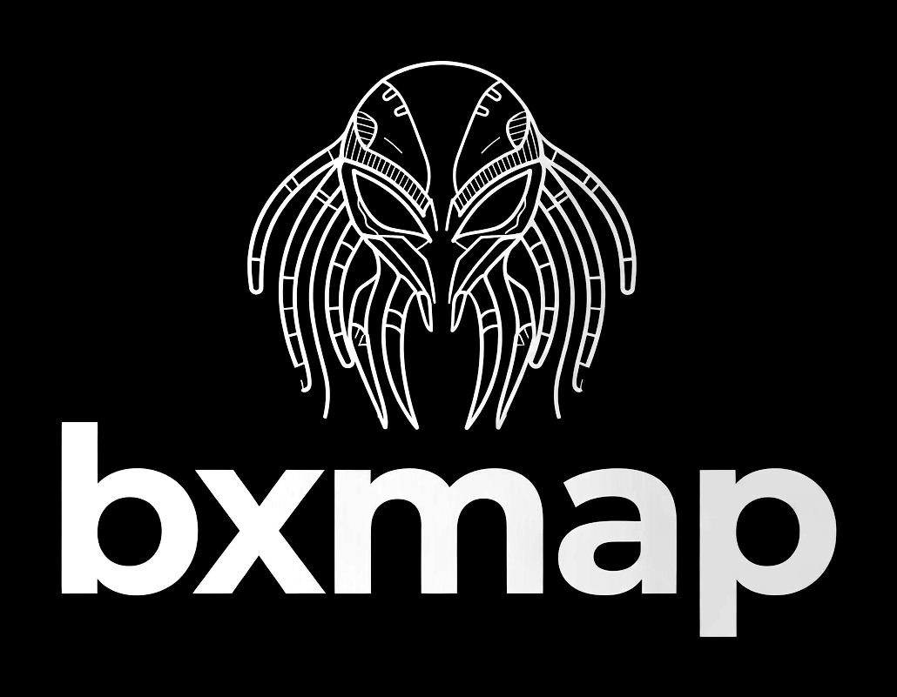

# bxmap CLI

<p align="center">
  
</p>

<p align="center"><b>Fast, composable memory-dump extraction</b></p>

Command-line frontend for the `bxmap` memory-dump string extraction library.

## Install

```bash
cargo install bxmap-cli
# or
cargo binstall bxmap-cli
```

## Quick start

```bash
bxmap memory.dmp --auto-tune
bxmap memory.dmp --encoding ascii --format json -o strings.json
bxmap memory.dmp --entropy --format json -o triage.json

# Scan several dumps concurrently; each gets its own output file
bxmap --parallel-files 3 --output-dir case-results lab1.raw lab4.raw lab6.raw --format ndjson

# Presets (opt-in; without --mode the defaults are unchanged)
bxmap memory.dmp --mode triage -o case1.ndjson
bxmap memory.dmp --mode deep

bxmap --help
```

`-o` picks the writer from the extension (`.json`, `.ndjson`, `.csv`, `.md`,
`.html`, `.txt`; a trailing `.gz` is ignored) unless `--format` is given. The
ASCII logo is printed by `--help` only, so scans keep stderr clean.

## Useful flags

- `--mode <quick|triage|deep>` — opt-in preset. `quick` is the historical
  default (a no-op). `triage` scans ascii/utf16/utf8 with `--min-len 5` and
  enables detectors, artifacts, `--dedupe`, `--magic-bytes` and
  `--report summary` (unlimited `--max-strings` when `-o` is used). `deep` adds
  all encodings, merged entropy regions (`--entropy-merge --entropy-no-data`)
  and carving into `<input>.bxmap/carved`. A preset only fills flags you did not
  pass, so explicit flags win in any position.
- `--encoding <all|ascii|utf16|utf32|latin1|cp1252|utf8|shift_jis>` — restrict
  extracted strings by encoding. Also accepts a comma-separated list
  (`ascii,utf16,utf8`); single values keep their previous meaning. Shift-JIS is
  decoded with encoding_rs; build with `--no-default-features` (or drop
  `shift-jis`) and the legacy table-based decoder is used.
- `--min-len <N>` — minimum string length.
- `--max-str-len <N>` — truncate very long strings in output.
- `--max-strings <N>` — maximum results (default 200000; `0` = unlimited).
  When the limit stops the scan early the CLI warns and exits with code `3`.
- `--start <OFFSET>` / `--end <OFFSET>` — scan only the byte range
  `[start, end)` (decimal or `0x` hex). Use this to split a large dump across
  several processes. Strings that cross a boundary are still read in full
  (the scanner overlaps by `MAX_RUN_CHARS` on each side), but only strings
  whose start offset falls inside the range are emitted. A range forces the
  sequential streaming scanner even with `--threads`. Auxiliary stages
  (`--magic-bytes`, `--yar`, `--brute-xor`, `--entropy`) still scan the whole
  file but only report hits that overlap the requested range.
- `--dedupe` — emit each unique string once, with `count=<N>` and the first
  (lowest) offset. With `--detect-format rich` findings are grouped by
  `(rule, value)` instead. Buffers results in memory, so it disables the
  streaming output path.
- `--progress` / `--no-progress` — show or hide a live status line on stderr
  (percent, MiB/s, scanned offset). Auto-enabled when stderr is a terminal and
  results are not going to the terminal.
- `--format <text|json|json-tree|ndjson|csv|html|markdown>` — output format.
  `html` and `markdown` produce a self-contained analysis report. `ndjson` emits one
  JSON object per line with a `type` field (`string`, `finding`, `magic`,
  `yara`, `xor`, `entropy`, `artifact`) and a final `{"type":"metadata",...}`
  line carrying `total_records`, `truncated` and `scanned_until`. Prefer it for
  very large dumps: it streams and avoids the array wrapper of `json`. `csv`
  emits a fixed header plus `string`/`finding`/`artifact` rows (RFC 4180
  quoting) for spreadsheets and pandas; it cannot be combined with
  `--magic-bytes`, `--yar`, `--brute-xor` or `--entropy`.
- `-o, --output <PATH>` — write results to a file. The extension picks the
  writer (`.json`, `.ndjson`, `.csv`, `.md`, `.html`, `.txt`; a trailing `.gz`
  is allowed and transparent) unless `--format` is given. A `.gz` path is
  gzip-compressed on the fly, which keeps multi-hundred-MB JSON outputs small
  and the gzip stream stays valid even when the scan exits early.
- `--detect <list>` — IOC / credential triage.
- `--detect-format <flat|rich>` — `rich` keeps the original text and adds
  `rule`, `confidence`, `severity` and `context` to every finding.
- `--auto-tune` — choose a worker count for this machine.
- `--threads <N>` — fixed worker count. With `N > 1` the scan runs in parallel
  *and still streams*: each window of regions is scanned in parallel, emitted
  in ascending offset order, then dropped, so peak RAM stays bounded by
  `threads * 16 MiB` plus the results of the window instead of growing with
  the number of matches.
- `--parallel-files <N>` — batch mode: scan up to `N` input dumps at once.
  Supply two or more dump paths and `--output-dir <DIR>`; bxmap creates one
  uniquely named result per input and never mixes records from different
  dumps. `--threads` caps scanner workers per dump; bxmap also caps that value
  by the available CPU share for the active jobs. `--max-memory` is split
  across active jobs and caps scanner buffers.
  Progress bars are disabled in batch mode to keep status readable; do not pass
  `--progress` there. `--report` is also rejected for multiple inputs until
  report text can be isolated per dump. Minidump string scans with VA/module
  annotations are supported when you pass `--no-tree`; batch mode keeps the
  default minidump tree output out of stdout. VMware info, carving and
  reassembly are rejected until their per-file state and outputs can be
  isolated. One failed input
  does not stop the remaining files; failures are summarized at the end.
  Before starting workers, bxmap checks that none of the generated output paths
  already exists, so a rerun cannot silently truncate prior results. Results
  are written to sibling `.partial` files and published under their final names
  only after a successful scan; failed scans remove their partial output.
- `--xor-exhaustive` — with `--brute-xor 3b`, enumerate all 16,777,216 keys
  instead of the default frequency-guided search. Prints a byte-op estimate
  first; expect minutes on a large dump.
- `--compact` — minify `json`/`json-tree` output: one line, no indentation.
  Handy for large exports and for piping into other tools.
- `--extract <list>` — also emit deduped artifacts collected from the
  extracted strings: `paths`, `env`, `urls`, `emails`, `registry`, `tools` or
  `all` (comma-separated). Each artifact carries the first offset, an
  occurrence count and an optional `detail` string
  (`user=<name>;category=<...>` for paths, `name=...;sensitive=true` for
  credentials, `evidence=...;category=...;trace=...` for tools). Artifacts are
  sorted rarest-first and appended after the normal rows. Supported with
  `text`, `json`, `ndjson` and `csv`; `json-tree` is rejected because
  artifacts are a flat record type. The library equivalent is
  `bxmap::artifacts::ArtifactCollector`.
- `--extract tools` names the memory-capture/analysis tooling found in the
  dump: DumpIt, WinPmem, FTK Imager, Magnet RAM Capture, Belkasoft RAM
  Capturer, LiME, AVML, Volatility, Rekall, ProcDump, plus default image names
  (`DESKTOP-<host>-<date>-<time>.raw`, `physicalmemory.mem`, `memory.raw`,
  `ramdump.mem`). Matching is case-insensitive with word boundaries, each
  string counts once per tool, and `trace=` lists every evidence kind seen
  (`path`, `command`, `prefetch`, `filename`, `string`).
- `--report <mode>` — report mode: `none` (default), `summary`, `user`, `all`.
  `summary`: string counts per encoding, scanned byte range, limit status, top
  artifacts (requires `--extract`). `user`: consolidated per-user file list (one
  line per user) when `--extract paths` is active; shows file count, AppData
  count, and AppData percentage. Filter with `--min-files-in-user <N>`.
  `all`: both summary and user reports.
- `--min-files-in-user <N>` — minimum file count for a user to appear in
  `--report user|all` (default 0).
- `--filter-appdata` — in `--report user|all`, compute AppData percentage using
  visible files (total minus AppData) as denominator. Does not remove AppData
  paths from collection.
- `--entropy` — report high-entropy regions.
- `--entropy-window <BYTES>` — bytes per entropy window (default 65536).
- `--entropy-threshold <BITS>` — minimum Shannon entropy per window, 0–8
  (default 7.2).
- `--entropy-merge` — merge contiguous high-entropy windows into a single
  region; the reported entropy is computed exactly over the whole run.
- `--entropy-max-data <BYTES>` — keep at most this many payload bytes per
  region (default 4096, `0` keeps none). Capped records carry
  `data_truncated: true` in JSON and `data_truncated=1` in text.
- `--entropy-no-data` — with `--entropy`, omit the `data_hex` payload and keep
  only `offset`, `length` and `entropy`.

### File carving (`--carve`)

- `--carve [types]` — recover structured files and write them to `--carve-out`.
  With no value, `--carve` is a **full carve**: every format below, the whole
  dump (same as `--carve all`). The next argument is only read as a type list
  when it parses as one, so `bxmap --carve dump.bin` still treats `dump.bin`
  as the dump path.
  Types: `jpeg`, `png`, `gif`, `bmp`, `tif`, `ico`, `webp`, `zip`, `rar4`, `rar5`,
  `7z`, `gzip`, `bz2`, `xz`, `tar`, `pdf`, `rtf`, `ole`, `sqlite`, `pe`, `elf`,
  `class`, `dex`, `wasm`, `lnk`, `evtx`, `pcap`, `pcapng`, `kdbx`, `pem`, `mp4`,
  `avi`, `wav`, `mkv`, `webm`, `ogg`, `opus`, `flac`, `mp3`, `vdi`, `vmdk`, `all`,
  `text`, `bin`, `headloss` (comma-separated). `text` recovers plaintext (notes, logs, Markdown,
  source dumps) by content rather than by magic; it is not part of `all` - ask
  for it with `--carve text` or `--carve all,text`. Its boundaries are a
  heuristic, so recovered text lands in `partial/` with `complete: false` and
  a `text:region` note (region offsets, newline-cut, content sniff). `bin` recovers unclassified high-entropy runs
  (compressed, encrypted or packed data that no other type claimed, 16 KiB or
  more) the same opt-in way (`--carve bin` or `--carve all,bin`): each run
  lands in `partial/` as `...bin.carved` with `complete: false`, `tier` 3 and
  `entropy` evidence, split into `--carve-max-size` pieces. `headloss`
  recovers the clean tail of a file whose head was overwritten with random
  bytes, the same opt-in way (`--carve headloss` or `--carve all,headloss`):
  the header pass cannot see such a file (its magic is gone), so the pass
  looks for the entropy drop, a high-entropy run followed by structured
  data. Each structured run of 8 KiB or more lands in `partial/` as
  `...bin.tail.carved` with `role: "tail"`, `complete: false`, `tier` 3,
  `entropy_drop` evidence, `corrupted_offset` at its first byte and a
  `salvage:head4k` note. Edges are refined byte-wise and kept a few
  hundred bytes inside the clean side, so no random byte leaks in; zeros
  and wiped gaps are never carved, and each tail is capped at
  `--carve-max-size` (64 MiB when unset). The format stays unknown and
  nothing is rebuilt. Aliases: `rar` (both RAR versions), `jpg` (jpeg), `7zip`
  (7z), `office`/`ms-office` (ole), `exe`/`executable` (pe), `db`/`sqlite3`
  (sqlite) and `tiff` (tif). Extensions that share a container are **exact
  filters** (the dump is still scanned once per format; only what gets written
  changes): `docx`/`xlsx`/`pptx`/`odt`/`ods`/`odp`/`jar`/`apk` (zip),
  `doc`/`xls`/`ppt`/`msi`/`msg` (ole), `dll`/`sys` (pe), `mov`/`m4a` (mp4) and
  `so` (elf). `--carve docx` writes only files whose sniffed extension is
  `docx`, `--carve docx,xlsx` writes both, and `--carve zip` still writes every
  ZIP, docx/xlsx/jar included (each named by its sniffed extension). Naming a
  format both ways (`docx,zip`) keeps the whole format. A ZIP whose central
  directory is gone cannot be sniffed and stays `zip`, as do footer-salvaged
  tails, so an exact filter skips them: use `--carve zip` to get those. Skipped
  files are counted as `filtered` in the summary and do not count toward
  `--carve-max-total` or `--carve-max-files`. Formats without a
  magic number are not carved, except plaintext via `text` above. Every
  candidate is structurally validated before
  writing; nothing is decrypted, decompressed, or executed.
  Types select file formats only, never a technique: every carve runs the
  full recovery stack, including a footer-first second pass for ZIP
  (central directory + end record), PDF (`startxref` + `%%EOF`) and PNG
  (the IDAT run before `IEND`) tails whose header is gone, e.g. after
  partial encryption, and a rebuild pass for MP4/MOV files whose head is
  encrypted: when the original `ftyp`/`mdat` header is gone but the `moov`
  box (usually at the end) survives, bxmap parses `moov` (`mvhd`, tracks,
  `stbl` with `stsd`/`stts`/`stsc`/`stsz` or `stz2`/`stco` or `co64`),
  cross-checks the tables (samples vs chunk counts, monotonic chunk
  offsets) and writes a **fresh `ftyp` + `mdat` header with every chunk
  offset shifted**. The rebuilt file replaces only the header: the head
  was encrypted, so the first frames are garbage, but what was not
  encrypted can play. A `stco` table whose entries would overflow 32 bits
  after the shift is promoted to `co64`; nothing is truncated to the
  4 GB limit of the reference repair tools. The ransomware trailer after
  `moov` (often a victim ID) is cut out of the rebuilt file and recorded
  in the index (`trailer_offset`, `trailer_len`, `trailer_sha256`,
  `trailer_preview`, hex + ASCII). Fragmented MP4s (`mvex`) and compressed
  moovs (`cmov`) are rejected with a reason. Rebuilt files are labelled
  `role: "rebuilt"`, land in `partial/` (`complete: false`), tier 2,
  `confidence: medium`, named `{offset:08x}-mp4-{sha8}.mp4.rebuilt.carved`.
  When the NAL oracle finds a surviving sync sample, an edit-list cut is
  written alongside it: `role: "cut"`, same payload and sample tables,
  but each `trak` gains an `edts`→`elst` pair with `media_time` at the
  first intact sync sample (`segment_duration` `0xFFFFFFFF`, rate 1.0) so
  playback starts where the video is intact. Named
  `{offset:08x}-mp4-{sha8}.mp4.cut.carved`, evidence gains `elst_cut`;
  the full rebuilt file is always kept and no flag is needed.
  Tails are cut out and written to `partial/` with notes starting
  `salvage:tail`. A tail is walked back until the first high-entropy window
  (>= 7.8 bits/byte), a file already carved, or `--carve-max-size`.
  JPEG is not salvaged yet (weak `FF D9` footer, compressed body).
  Heuristic only: compressed data also has high entropy. Incomplete files
  (`complete: false`) always land in `partial/`.
- `--carve-out <dir>` — destination directory (default `<input>.bxmap/carved`).
  Existing files are never overwritten; re-running into the same directory
  exits with an error.
- `--carve-index <file>` — write the carve index. `.ndjson` = one record per
  line; anything else = JSON array. The index is a separate channel from
  `--format` so carving never reshapes the string output.
  Each record has `offset`, `offset_hex`, `type`, `size`, `sha256`, `entropy`,
  `complete`, `corrupted_offset`, `entropy_spike_at`, `partial_encryption`,
  `trailer_offset`, `trailer_len`, `trailer_sha256`, `trailer_preview`,
  `tracks_intact`, `notes`, `path`, and `duplicates`. For incomplete files
  `corrupted_offset`
  is where structural validation stopped and `entropy_spike_at` is the first
  4 KiB window that jumps to >= 7.8 bits/byte after structured data (both
  `null` otherwise). `partial_encryption` is `null`, or an object
  `{ "period": <bytes>, "duty": <0-1>, "threshold": 7.8 }` when the file
  shows a repeating high-entropy phase (e.g. every 4th 4 KiB window) - the
  signature of file-system encryption that encrypts a fraction of every
  file. Heuristic hint, **not** a ransomware verdict: compressed data also
  scores as high entropy. Fully structured and uniformly high (compressed or
  encrypted end to end) files produce `null`. `trailer_offset`,
  `trailer_len`, `trailer_sha256` and `trailer_preview` (hex + ASCII, max
  64 bytes) are non-null only for `role: "rebuilt"` and `role: "cut"` files: they describe
  the ransomware trailer that followed the original `moov` box, cut out of
  the rebuilt file (len capped at 1 MiB of the source remainder); every
  other role gets `null`. `tracks_intact` is `null` outside rebuilt/cut MP4s,
  and an array of per-video-track verdicts otherwise:
  `{ "codec": "avc1", "samples": N, "intact": N, "intact_ratio": 0-1,
  "broken_prefix_samples": N, "first_intact_sync_sample": N|null,
  "first_intact_sync_time": seconds|null }`. The NAL oracle checks that
  every NAL in the sample is exactly consumed - the encoder's own
  guarantee, so an intact frame parses cleanly and an encrypted one almost
  never does. `first_intact_sync_sample` comes from `stss` (absent table =
  every sample counts as sync) and `first_intact_sync_time` from the
  `mvhd` timescale + `stts` deltas. Audio tracks are not checked (no
  oracle) and are absent from the array. `confidence` is `high` only when
  every checked video track is 100% intact at dump offset 0, `low` when
  nothing survived. When at least one video track has a surviving sync
  sample, a `role: "cut"` sibling is written alongside the full rebuild
  as `.mp4.cut.carved`: identical payload and sample tables, but every
  `trak` carries an `edts` -> `elst` pair whose `media_time` (in each
  track's `mdhd` timescale) starts presentation at the first intact
  sync sample, so the encrypted head is never decoded.
  `segment_duration` is `0xFFFFFFFF` (rest of the track) and rate is
  1.0. Evidence gains `elst_cut`; the full rebuilt file is always kept
  next to it, and no flag is needed.
  Records also carry the evidence behind each file, so scripts do not have to
  parse the name: `file_name`, `ext` and `ext_source` (`kind`,
  `sniff:<rule>` or `fallback`), `role` (`whole`, `tail`, `reassembled`, `rebuilt`, `cut`),
  `tier` (1 = structure validated to the terminator, 2 = header valid but
  incomplete or a footer-found tail, 3 = readable text only), `evidence` (the
  checks that back it: `magic`, `structure_ok`, `terminator_ok`,
  `structure_partial`, `footer`, `text_ratio`, `sniff:<rule>`,
  `suspected-partial-encryption` when the periodic heuristic matched,
  `moov_ok`, `tables_cross_ok`, `chunk_range_ok` on rebuilt MP4s, `elst_cut` on cut MP4s, and
  `nal_oracle` when the NAL scan ran) and
  `confidence` (`high`, `medium`, `low`). `--report summary` adds the file
  count per tier and per extension, e.g. `(tier T1=3 T2=1; ext docx=3 png=1)`.
- Incomplete files (`complete: false`) are always written into a `partial/`
  subfolder of `--carve-out` so repair tools (Untrunc, 7-Zip recovery, manual
  header splicing) can take that folder as input. They carry `corrupted_offset`
  and `entropy_spike_at` in the index.
- `--carve-min-size <N>` — skip files smaller than N bytes (default 64).
- `--carve-max-size <N>` — per-file ceiling; header-declared sizes are clamped
  to it (default 64 MiB).
- `--carve-max-total <N>` — stop after writing N bytes (default 512 MiB,
  `0` = no limit). Hitting it exits with code 3.
- `--carve-max-files <N>` — stop after N files (default 1000). Hitting it exits
  with code 3.
- `--carved`, `--carved-out`, `--carved-index`, `--carved-min-size`,
  `--carved-max-size`, `--carved-max-total`, `--carved-max-files` — aliases of
  the matching `--carve*` option. After parsing there is one configuration, so
  file names, index and behaviour are identical whichever spelling is used
  (bare `--carved` is a full carve like bare `--carve`). Giving both spellings
  of one option (`--carve-out a --carved-out b`) is an error. In `bxmap.toml`
  the keys `carved` and `carved-out` are accepted as aliases of `carve` and
  `carve-out` (both spellings of one key is an error).

```powershell
# Full carve: bare --carve = every format, whole dump, default output dir
bxmap dump.bin --carve

# Carve everything, write NDJSON index, no string scan
bxmap dump.bin --carve all --carve-out carved --carve-index idx.ndjson --max-strings 0 --report none

# Only JPEG and PNG, limit to 100 MiB total
bxmap dump.bin --carve jpeg,png --carve-out carved --carve-max-total 104857600

# JSON array index
bxmap dump.bin --carve all --carve-out carved --carve-index idx.json

# Ransomware aftermath: --carve always salvages ZIP/PDF tails whose header was encrypted
bxmap dump.bin --carve --carve-index idx.ndjson
```

⚠️ **Malware handling warning**: Carved files are raw bytes from the dump.
They may contain malicious code, exploits, or encrypted payloads. Treat every
`.carved` file as untrusted: inspect in a sandbox/VM, never open on a host
machine, and do not execute them.

Carved files are named `{offset}-{kind}-{sha8}.{ext}.carved` (for example
`0001a2b0-zip-9f3c1e2a.zip.carved`, `…exe.carved`); plaintext is `.txt.carved`, and a
salvaged tail without its header is `.{ext}.tail.carved`. `.carved` is always the last
extension so a double-click cannot open or run the file; to use one, remove the trailing
`.carved` yourself, inside an isolated environment.

When the content proves a more specific type, the extension is refined: a ZIP holding Word parts
becomes `.docx.carved`, a PE with the DLL flag `.dll.carved`, and so on (`xlsx`, `pptx`, `odt`,
`ods`, `odp`, `apk`, `jar`, `doc`, `xls`, `ppt`, `msg`, `msi`, `sys`, `m4a`, `mov`, `so`). Without
proof the default stays (`.zip.carved`, `.ole.carved`, `.exe.carved`). The bytes are never changed.

### Binary signature scanning (`--signature`)

- `--signature magic` — report executable/document magic-byte signatures
  (PE, ELF, ZIP/Office, PDF, PNG, RAR, 7z, GZIP, SQLite...).
- `--signature keys` — scan the dump for stored private-key material: DER
  PKCS#8 envelopes (RSA / EC) and OpenSSH binary private-key blobs. Each hit
  is reported as a `KEY` record with offset, key family, algorithm, length and
  SHA-1 fingerprint. Raw key bytes are never surfaced; nothing is decrypted.
- `--signature all` — both `magic` and `keys` together.
- Types are comma-separated, e.g. `--signature magic,keys`.

Exit behavior: `--signature` does not change exit codes. It is an auxiliary
stage like `--entropy` and reports candidates regardless of the string-scan
limits.

```powershell
# Find candidate keys that may unlock an encrypted container
bxmap dump.bin --signature keys --no-progress

# NDJSON key records
bxmap dump.bin --signature keys --format ndjson --no-progress

# Both magic bytes and key candidates
bxmap dump.bin --signature magic,keys --no-progress
```

⚠️ **Scope**: bxmap does not decrypt, crack, or brute-force passwords. `--signature keys`
only *finds* candidate key material so an analyst can try it offline against a
located container. A `KEY` record is a heuristic signal, not proof the key fits.

## Input auto-detection

The input is sniffed before scanning, so the common forensic formats need no
flag:

- a Windows minidump (`MDMP` magic) enables `--tree` + `--map-va`; scanning it
  requires `--no-tree` (and `--no-map-va` for plain rows);
- `.vmss`/`.vmsn` enables `--vmware-info`; use `--no-vmware-info` to scan the
  snapshot like a normal image;
- `.vmem` is always scanned as a plain RAM image.

Each detection prints a one-line hint on stderr naming what it enabled.

## Reporting notes

The `throughput` line in `--report summary` is computed over the bytes that
were actually scanned. A run stopped by `--max-strings` therefore reports the
real rate for the small prefix it read, instead of dividing the whole file size
by a short elapsed time and printing an inflated number.

When more than 10,000 results are about to be printed to a terminal (no `-o`),
the CLI adds a hint to write them to a file instead.

## Exit codes

| Code | Meaning |
|------|---------|
| `0` | Scan finished and every extracted record was written. |
| `1` | Usage or I/O error (bad flag, unreadable input, failed write). The message goes to stderr. |
| `3` | `--max-strings`, `--carve-max-total`, or `--carve-max-files` stopped the scan/carve early. Results are incomplete; the warning names the offset where it stopped. Re-run with a larger limit or `--max-strings 0` / remove the carve cap. |

`--report summary` repeats the limit status in the closing summary, and
`json-tree`/`ndjson`/`carve-index` carry `truncated` metadata so scripts can
detect code `3` without parsing stderr.

For library usage see the crate README at <https://docs.rs/bxmap>.

---

## Tips & Optimal Commands for Malware/DFIR Triage

Ready-to-copy `bxmap-cli` commands grouped by triage target. Replace `<dump.raw>` with your dump file path.

### 1. Quick triage (under 30 s, top findings immediately)

```powershell
.\target\release\bxmap-cli.exe <dump.raw> --mode quick --detect secret --report summary --stats
```

- `--mode quick`: default preset (common encodings, detections, artifacts).
- `--detect secret`: scan credentials, tokens, API keys, URLs, IPs on strings.
- `--report summary`: print top-12 priority findings to stderr plus summary table.
- `--stats`: counts, entropy, elapsed time, throughput.

### 2. Deep triage (recommended for real dumps)

```powershell
.\target\release\bxmap-cli.exe <dump.raw> --mode deep --max-strings 0 --signature all --detect all --entropy --format ndjson --output triage.ndjson --stats
```

- `--max-strings 0`: no cap, scan entire dump.
- `--signature all`: magic bytes (PE/ELF/PDF/ZIP/…) + private-key candidates (RSA/EC/OpenSSH).
- `--detect all`: all IOCs (ip, url, domain, base64, secret).
- `--entropy`: encrypted/packed regions (entropy 7.2-8.0/8.0) - typical of packed malware.
- `--format ndjson --output triage.ndjson`: one JSON record per line, easy to filter with `jq` / Python.
- `--stats`: full summary table.

### 3. Carve executables only (PE/EXE/DLL) - most critical group

```powershell
.\target\release\bxmap-cli.exe <dump.raw> --mode deep --max-strings 0 --carve pe,exe,dll --carve-out ./carved_pe --carve-max-files 5000 --carve-max-total 0 --stats
```

- `--carve pe,exe,dll`: only executables, no image/video noise.
- `--carve-max-files 5000`: cap at 5,000 files (adjust for disk).
- `--carve-max-total 0`: unlimited carved bytes (careful on small disks).

### 4. Carve everything (full recovery)

```powershell
.\target\release\bxmap-cli.exe <dump.raw> --mode deep --max-strings 0 --carve all --carve-out ./carved_all --carve-max-files 10000 --carve-max-total 536870912 --format ndjson --output triage.ndjson --stats
```

- `--carve all`: all supported formats (41 kinds: images, archives, documents, executables, media, disk images, captures, logs, …).
- `--carve-max-total 536870912`: 512 MB cap total (avoids filling disk).

### 5. Minidump inputs (.mdmp / .hdmp / .dmp)

```powershell
.\target\release\bxmap-cli.exe <dump.mdmp> --mode deep --map-va --tree --max-strings 0 --detect all --entropy --stats
```

- `--map-va`: map file offsets to virtual addresses via minidump VA map.
- `--tree`: print minidump process tree.

---

### Flag reference

| Flag | Meaning |
|------|---------|
| `--mode quick\|triage\|deep` | Preset: quick = defaults; triage = quick + detections; deep = triage + all encodings + entropy + carving. |
| `--max-strings N` | Result cap (default 200,000; `0` = unlimited). |
| `--max-memory BYTES` | Cap the scanner's own RAM (0 = unlimited); fewer workers are used when the cap requires it. |
| `--config FILE` | Read defaults from a TOML file (default: `./bxmap.toml` when it exists). Command line flags win over the file, the file wins over `--mode`/`--with`. |
| `--detect all` | Scan ip, url, domain, base64, secret. |
| `--signature all` | Scan magic bytes + private-key candidates. |
| `--entropy` | Find encrypted/packed regions. |
| `--carve [types]` | Recover structured files into `--carve-out` (default `<input>.bxmap/carved`). No types = full carve of every format. |
| `--format ndjson --output file.ndjson` | Write ndjson for easy script parsing. |
| `--stats` | Final summary table. |

---

### Important notes

- **Time**: 1 GB dump ~1-2 min; 1.6 GB dump ~3-4 min (machine-dependent).
- **Carved size**: `--carve-max-total 0` can write hundreds of MB-GB. On small disks use `--carve-max-total <bytes>` (e.g. `536870912` = 512 MB).
- **Exit code 1**: usually means `--carve-max-files` or `--max-strings` cap reached, not a crash. Results still written to file. See "Exit codes" for details.
- **bxmap is a triage layer, not a full malware scanner**: it extracts evidence candidates (URLs, credentials, tools, encrypted regions, PE files). To conclude "this is malware", combine with Volatility (process/module), YARA rules, and sandbox (ANY.RUN / Cuckoo).

### Suggested workflow (phased)

```
Step 1: bxmap dump.raw --mode quick --detect secret --report summary --stats
        -> < 20 s triage, view top findings + artifacts immediately.

Step 2: bxmap dump.raw --mode deep --max-strings 0 --signature all --detect all --entropy --format ndjson --output triage.ndjson --stats
        -> Deep scan, save all to ndjson for later filtering.

Step 3: bxmap dump.raw --mode deep --max-strings 0 --carve pe,exe,dll --carve-out ./carved --carve-max-files 5000 --stats
        -> Carve 200-500 PE files, run strings / check imports / hash on VirusTotal.

Step 4: Run Volatility on same dump to enumerate processes, modules, network connections.
        Combine with YARA rules + sandbox for suspicious PE samples.
```

## License

The bxmap-cli frontend is licensed under the GNU Affero General Public License v3.0 only (see [LICENSE-AGPL](LICENSE-AGPL)).
The underlying bxmap library is dual-licensed under MIT OR Apache-2.0.
