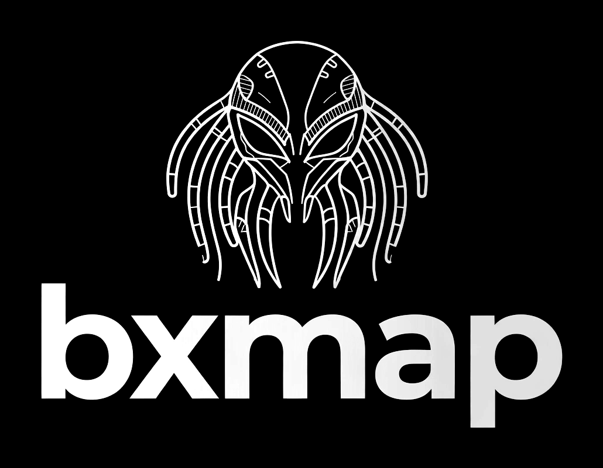

# bxmap CLI

<p align="center">
  
</p>

<p align="center"><b>Fast, composable memory-dump extraction</b></p>

Command-line frontend for the `bxmap` memory-dump string extraction library.

## Install

```bash
cargo install bxmap-cli
# or
cargo binstall bxmap-cli
```

## Quick start

```bash
bxmap memory.dmp --auto-tune
bxmap memory.dmp --encoding ascii --format json -o strings.json
bxmap memory.dmp --entropy --format json -o triage.json

# Presets (opt-in; without --mode the defaults are unchanged)
bxmap memory.dmp --mode triage -o case1.ndjson
bxmap memory.dmp --mode deep

bxmap --help
```

`-o` picks the writer from the extension (`.json`, `.ndjson`, `.csv`, `.md`,
`.html`, `.txt`; a trailing `.gz` is ignored) unless `--format` is given. The
ASCII logo is printed by `--help` only, so scans keep stderr clean.

## Useful flags

- `--mode <quick|triage|deep>` — opt-in preset. `quick` is the historical
  default (a no-op). `triage` scans ascii/utf16/utf8 with `--min-len 5` and
  enables detectors, artifacts, `--dedupe`, `--magic-bytes` and
  `--report summary` (unlimited `--max-strings` when `-o` is used). `deep` adds
  all encodings, merged entropy regions (`--entropy-merge --entropy-no-data`)
  and carving into `<input>.bxmap/carved`. A preset only fills flags you did not
  pass, so explicit flags win in any position.
- `--encoding <all|ascii|utf16|utf32|latin1|cp1252|utf8|shift_jis>` — restrict
  extracted strings by encoding. Also accepts a comma-separated list
  (`ascii,utf16,utf8`); single values keep their previous meaning. Shift-JIS is
  decoded with encoding_rs; build with `--no-default-features` (or drop
  `shift-jis`) and the legacy table-based decoder is used.
- `--min-len <N>` — minimum string length.
- `--max-str-len <N>` — truncate very long strings in output.
- `--max-strings <N>` — maximum results (default 200000; `0` = unlimited).
  When the limit stops the scan early the CLI warns and exits with code `3`.
- `--start <OFFSET>` / `--end <OFFSET>` — scan only the byte range
  `[start, end)` (decimal or `0x` hex). Use this to split a large dump across
  several processes. Strings that cross a boundary are still read in full
  (the scanner overlaps by `MAX_RUN_CHARS` on each side), but only strings
  whose start offset falls inside the range are emitted. A range forces the
  sequential streaming scanner even with `--threads`. Auxiliary stages
  (`--magic-bytes`, `--yar`, `--brute-xor`, `--entropy`) still scan the whole
  file but only report hits that overlap the requested range.
- `--dedupe` — emit each unique string once, with `count=<N>` and the first
  (lowest) offset. With `--detect-format rich` findings are grouped by
  `(rule, value)` instead. Buffers results in memory, so it disables the
  streaming output path.
- `--progress` / `--no-progress` — show or hide a live status line on stderr
  (percent, MiB/s, scanned offset). Auto-enabled when stderr is a terminal and
  results are not going to the terminal.
- `--format <text|json|json-tree|ndjson|csv|html|markdown>` — output format.
  `html` and `markdown` produce a self-contained analysis report. `ndjson` emits one
  JSON object per line with a `type` field (`string`, `finding`, `magic`,
  `yara`, `xor`, `entropy`, `artifact`) and a final `{"type":"metadata",...}`
  line carrying `total_records`, `truncated` and `scanned_until`. Prefer it for
  very large dumps: it streams and avoids the array wrapper of `json`. `csv`
  emits a fixed header plus `string`/`finding`/`artifact` rows (RFC 4180
  quoting) for spreadsheets and pandas; it cannot be combined with
  `--magic-bytes`, `--yar`, `--brute-xor` or `--entropy`.
- `-o, --output <PATH>` — write results to a file. The extension picks the
  writer (`.json`, `.ndjson`, `.csv`, `.md`, `.html`, `.txt`; a trailing `.gz`
  is allowed and transparent) unless `--format` is given. A `.gz` path is
  gzip-compressed on the fly, which keeps multi-hundred-MB JSON outputs small
  and the gzip stream stays valid even when the scan exits early.
- `--detect <list>` — IOC / credential triage.
- `--detect-format <flat|rich>` — `rich` keeps the original text and adds
  `rule`, `confidence`, `severity` and `context` to every finding.
- `--auto-tune` — choose a worker count for this machine.
- `--threads <N>` — fixed worker count. With `N > 1` the scan runs in parallel
  *and still streams*: each window of regions is scanned in parallel, emitted
  in ascending offset order, then dropped, so peak RAM stays bounded by
  `threads * 16 MiB` plus the results of the window instead of growing with
  the number of matches.
- `--xor-exhaustive` — with `--brute-xor 3b`, enumerate all 16,777,216 keys
  instead of the default frequency-guided search. Prints a byte-op estimate
  first; expect minutes on a large dump.
- `--compact` — minify `json`/`json-tree` output: one line, no indentation.
  Handy for large exports and for piping into other tools.
- `--extract <list>` — also emit deduped artifacts collected from the
  extracted strings: `paths`, `env`, `urls`, `emails`, `registry`, `tools` or
  `all` (comma-separated). Each artifact carries the first offset, an
  occurrence count and an optional `detail` string
  (`user=<name>;category=<...>` for paths, `name=...;sensitive=true` for
  credentials, `evidence=...;category=...;trace=...` for tools). Artifacts are
  sorted rarest-first and appended after the normal rows. Supported with
  `text`, `json`, `ndjson` and `csv`; `json-tree` is rejected because
  artifacts are a flat record type. The library equivalent is
  `bxmap::artifacts::ArtifactCollector`.
- `--extract tools` names the memory-capture/analysis tooling found in the
  dump: DumpIt, WinPmem, FTK Imager, Magnet RAM Capture, Belkasoft RAM
  Capturer, LiME, AVML, Volatility, Rekall, ProcDump, plus default image names
  (`DESKTOP-<host>-<date>-<time>.raw`, `physicalmemory.mem`, `memory.raw`,
  `ramdump.mem`). Matching is case-insensitive with word boundaries, each
  string counts once per tool, and `trace=` lists every evidence kind seen
  (`path`, `command`, `prefetch`, `filename`, `string`).
- `--report <mode>` — report mode: `none` (default), `summary`, `user`, `all`.
  `summary`: string counts per encoding, scanned byte range, limit status, top
  artifacts (requires `--extract`). `user`: consolidated per-user file list (one
  line per user) when `--extract paths` is active; shows file count, AppData
  count, and AppData percentage. Filter with `--min-files-in-user <N>`.
  `all`: both summary and user reports.
- `--min-files-in-user <N>` — minimum file count for a user to appear in
  `--report user|all` (default 0).
- `--filter-appdata` — in `--report user|all`, compute AppData percentage using
  visible files (total minus AppData) as denominator. Does not remove AppData
  paths from collection.
- `--entropy` — report high-entropy regions.
- `--entropy-window <BYTES>` — bytes per entropy window (default 65536).
- `--entropy-threshold <BITS>` — minimum Shannon entropy per window, 0–8
  (default 7.2).
- `--entropy-merge` — merge contiguous high-entropy windows into a single
  region; the reported entropy is computed exactly over the whole run.
- `--entropy-max-data <BYTES>` — keep at most this many payload bytes per
  region (default 4096, `0` keeps none). Capped records carry
  `data_truncated: true` in JSON and `data_truncated=1` in text.
- `--entropy-no-data` — with `--entropy`, omit the `data_hex` payload and keep
  only `offset`, `length` and `entropy`.

### File carving (`--carve`)

- `--carve <types>` — recover structured files and write them to `--carve-out`.
  Types: `jpeg`, `png`, `zip`, `rar4`, `rar5`, `7z`, `pdf`, `gzip`, `bmp`,
  `sqlite`, `ole`, `mp4`, `pe`, `elf`, `all` (comma-separated). Aliases: `rar`
  (both RAR versions), `jpg` (jpeg), `7zip` (7z), `office`/`ms-office` (ole),
  `exe`/`executable` (pe). Every candidate is structurally validated before
  writing; nothing is decrypted, decompressed, or executed.
- `--carve-out <dir>` — destination directory (required with `--carve`).
  Existing files are never overwritten; re-running into the same directory
  exits with an error.
- `--carve-index <file>` — write the carve index. `.ndjson` = one record per
  line; anything else = JSON array. The index is a separate channel from
  `--format` so carving never reshapes the string output.
  Each record has `offset`, `offset_hex`, `type`, `size`, `sha256`, `entropy`,
  `complete`, `notes`, `path`, and `duplicates`.
- `--carve-min-size <N>` — skip files smaller than N bytes (default 64).
- `--carve-max-size <N>` — per-file ceiling; header-declared sizes are clamped
  to it (default 64 MiB).
- `--carve-max-total <N>` — stop after writing N bytes (default 512 MiB,
  `0` = no limit). Hitting it exits with code 3.
- `--carve-max-files <N>` — stop after N files (default 1000). Hitting it exits
  with code 3.

```powershell
# Carve everything, write NDJSON index, no string scan
bxmap dump.bin --carve all --carve-out carved --carve-index idx.ndjson --max-strings 0 --report none

# Only JPEG and PNG, limit to 100 MiB total
bxmap dump.bin --carve jpeg,png --carve-out carved --carve-max-total 104857600

# JSON array index
bxmap dump.bin --carve all --carve-out carved --carve-index idx.json
```

⚠️ **Malware handling warning**: Carved files are raw bytes from the dump.
They may contain malicious code, exploits, or encrypted payloads. Treat every
`.carved` file as untrusted: inspect in a sandbox/VM, never open on a host
machine, and do not execute them.

### Binary signature scanning (`--signature`)

- `--signature magic` — report executable/document magic-byte signatures
  (PE, ELF, ZIP/Office, PDF, PNG, RAR, 7z, GZIP, SQLite...).
- `--signature keys` — scan the dump for stored private-key material: DER
  PKCS#8 envelopes (RSA / EC) and OpenSSH binary private-key blobs. Each hit
  is reported as a `KEY` record with offset, key family, algorithm, length and
  SHA-1 fingerprint. Raw key bytes are never surfaced; nothing is decrypted.
- `--signature all` — both `magic` and `keys` together.
- Types are comma-separated, e.g. `--signature magic,keys`.

Exit behavior: `--signature` does not change exit codes. It is an auxiliary
stage like `--entropy` and reports candidates regardless of the string-scan
limits.

```powershell
# Find candidate keys that may unlock an encrypted container
bxmap dump.bin --signature keys --no-progress

# NDJSON key records
bxmap dump.bin --signature keys --format ndjson --no-progress

# Both magic bytes and key candidates
bxmap dump.bin --signature magic,keys --no-progress
```

⚠️ **Scope**: bxmap does not decrypt, crack, or brute-force passwords. `--signature keys`
only *finds* candidate key material so an analyst can try it offline against a
located container. A `KEY` record is a heuristic signal, not proof the key fits.

## Input auto-detection

The input is sniffed before scanning, so the common forensic formats need no
flag:

- a Windows minidump (`MDMP` magic) enables `--tree` + `--map-va`; scanning it
  requires `--no-tree` (and `--no-map-va` for plain rows);
- `.vmss`/`.vmsn` enables `--vmware-info`; use `--no-vmware-info` to scan the
  snapshot like a normal image;
- `.vmem` is always scanned as a plain RAM image.

Each detection prints a one-line hint on stderr naming what it enabled.

## Reporting notes

The `throughput` line in `--report summary` is computed over the bytes that
were actually scanned. A run stopped by `--max-strings` therefore reports the
real rate for the small prefix it read, instead of dividing the whole file size
by a short elapsed time and printing an inflated number.

When more than 10,000 results are about to be printed to a terminal (no `-o`),
the CLI adds a hint to write them to a file instead.

## Exit codes

| Code | Meaning |
|------|---------|
| `0` | Scan finished and every extracted record was written. |
| `1` | Usage or I/O error (bad flag, unreadable input, failed write). The message goes to stderr. |
| `3` | `--max-strings`, `--carve-max-total`, or `--carve-max-files` stopped the scan/carve early. Results are incomplete; the warning names the offset where it stopped. Re-run with a larger limit or `--max-strings 0` / remove the carve cap. |

`--report summary` repeats the limit status in the closing summary, and
`json-tree`/`ndjson`/`carve-index` carry `truncated` metadata so scripts can
detect code `3` without parsing stderr.

For library usage see the crate README at <https://docs.rs/bxmap>.

---

## Tips & Lệnh tối ưu cho triage mã độc / DFIR

Dưới đây là các lệnh `bxmap-cli` sẵn sàng copy-paste, nhóm theo mục tiêu thực tế. Thay `<dump.raw>` bằng đường dẫn file dump của bạn.

### 1. Triage nhanh (dưới 30 giây, lấy top findings ngay)

```powershell
.\target\release\bxmap-cli.exe <dump.raw> --mode quick --detect secret --report summary --stats
```

- `--mode quick`: preset mặc định (tất cả encoding phổ biến, detections, artifacts).
- `--detect secret`: quét credential, token, API key, URL, IP ngay trên strings.
- `--report summary`: in top 12 priority findings ra stderr, kèm bảng tóm tắt.
- `--stats`: hiện số lượng, entropy, thời gian, throughput.

### 2. Triage sâu (khuyến nghị cho dump thật)

```powershell
.\target\release\bxmap-cli.exe <dump.raw> --mode deep --max-strings 0 --signature all --detect all --entropy --format ndjson --output triage.ndjson --stats
```

- `--max-strings 0`: không cắt ngắn, quét hết dump.
- `--signature all`: quét magic bytes (PE/ELF/PDF/ZIP/…) + private-key candidates (RSA/EC/OpenSSH).
- `--detect all`: quét toàn bộ IOC (ip, url, domain, base64, secret).
- `--entropy`: tìm vùng mã hóa/packed (entropy 7.2–8.0/8.0) — điển hình mã độc packed.
- `--format ndjson --output triage.ndjson`: xuất ra file JSON dòng một dòng, dễ lọc bằng `jq` / Python sau này.
- `--stats`: hiện bảng tóm tắt đầy đủ.

### 3. Chỉ carve file executable (PE/EXE/DLL) — nhóm quan trọng nhất

```powershell
.\target\release\bxmap-cli.exe <dump.raw> --mode deep --max-strings 0 --carve pe,exe,dll --carve-out ./carved_pe --carve-max-files 5000 --carve-max-total 0 --stats
```

- `--carve pe,exe,dll`: chỉ carve file executable, tránh rác ảnh/video.
- `--carve-max-files 5000`: giới hạn 5.000 file (tùy chỉnh theo ổ cứng).
- `--carve-max-total 0`: không giới hạn tổng dung lượng carved (cẩn thận với ổ nhỏ).

### 4. Carve mọi thứ (khi cần khôi phục toàn diện)

```powershell
.\target\release\bxmap-cli.exe <dump.raw> --mode deep --max-strings 0 --carve all --carve-out ./carved_all --carve-max-files 10000 --carve-max-total 536870912 --format ndjson --output triage.ndjson --stats
```

- `--carve all`: carve tất cả định dạng hỗ trợ (jpeg, png, zip, rar, 7z, pdf, gzip, bmp, sqlite, ole, mp4, pe, elf…).
- `--carve-max-total 536870912`: giới hạn tổng 512 MB (tránh đầy ổ).

### 5. Dump là minidump (.mdmp / .hdmp / .dmp)

```powershell
.\target\release\bxmap-cli.exe <dump.mdmp> --mode deep --map-va --tree --max-strings 0 --detect all --entropy --stats
```

- `--map-va`: ánh xạ file offset về virtual address (minidump VA map).
- `--tree`: in minidump process tree.

---

### Giải thích flags thường dùng

| Flag | Ý nghĩa |
|------|---------|
| `--mode quick\|triage\|deep` | Preset: quick = mặc định; triage = quick + detections; deep = triage + tất cả encoding + entropy + carving. |
| `--max-strings N` | Giới hạn số chuỗi (mặc định 200.000; `0` = không giới hạn). |
| `--detect all` | Quét ip, url, domain, base64, secret. |
| `--signature all` | Quét magic bytes + private-key candidates. |
| `--entropy` | Tìm vùng mã hóa/packed. |
| `--carve <types>` | Khôi phục file có cấu trúc từ dump ra thư mục `--carve-out`. |
| `--format ndjson --output file.ndjson` | Xuất ra ndjson, dễ parse scripts. |
| `--stats` | Bảng tóm tắt kết thúc. |

---

### Lưu ý quan trọng

- **Thời gian**: dump 1 GB tầm 1–2 phút, dump 1.6 GB tầm 3–4 phút (tuỳ máy).
- **Dung lượng carved**: `--carve-max-total 0` có thể ghi hàng trăm MB–GB. Nếu ổ nhỏ, hãy đặt `--carve-max-total <byte>` (ví dụ `536870912` = 512 MB).
- **Exit code 1**: thường do `--carve-max-files` hoặc `--max-strings` đạt cap, không phải crash. Kết quả đã ghi ra file vẫn hợp lệ. Xem chi tiết mã thoát ở mục "Exit codes".
- **bxmap là tầng triage, không thay thế bộ phát hiện mã độc**: nó trích xuất các ứng viên bằng chứng (URL, credential, tool, vùng mã hóa, file PE). Để kết luận "đây là mã độc", hãy kết hợp với Volatility (process/module), YARA rules, và sandbox (ANY.RUN / Cuckoo).

### Workflow gợi ý (phân kỳ)

```
Bước 1: bxmap dump.raw --mode quick --detect secret --report summary --stats
        → Triage < 20 s, xem top findings + artifacts ngay.

Bước 2: bxmap dump.raw --mode deep --max-strings 0 --signature all --detect all --entropy --format ndjson --output triage.ndjson --stats
        → Quét sâu, lưu toàn bộ ra ndjson để lọc sau.

Bước 3: bxmap dump.raw --mode deep --max-strings 0 --carve pe,exe,dll --carve-out ./carved --carve-max-files 5000 --stats
        → Carve 200–500 file PE, sau đó chạy strings / kiểm tra imports / hash lên VirusTotal.

Bước 4: Dùng Volatility trên cùng dump để liệt kê process, module, kết nối mạng.
        Kết hợp với YARA rules + sandbox cho mẫu PE đáng ngờ nhất.
```